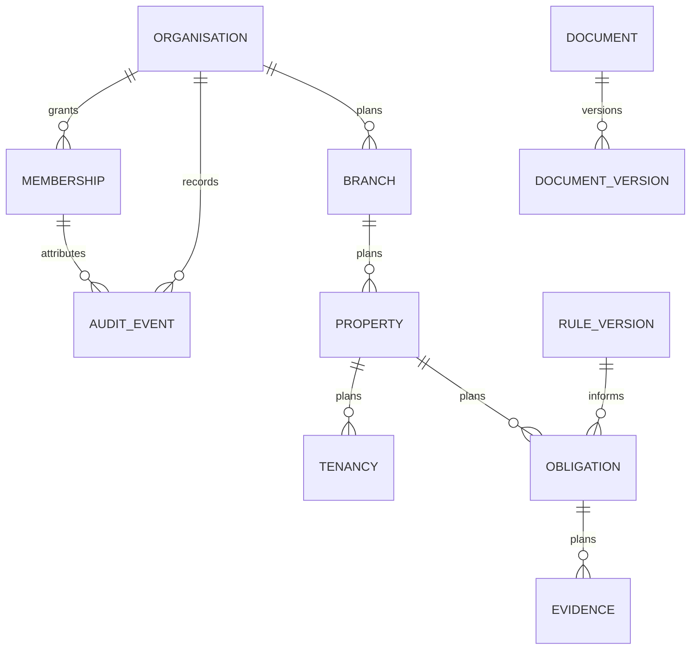

# Database design

| Foundation table | Fields and purpose |
|---|---|
| organisations | UUID tenant key, display name |
| memberships | Organisation and verified issuer/subject composite key, constrained role, active flag; reverse index for listing active memberships |
| audit_events | UUID event key, tenant and actor membership key, action and database timestamp; append-only runtime privileges |

Identity is keyed by the verified OIDC issuer and subject. Local provisioning uses migration credentials outside the app. When a request starts, bind the actor to the transaction, then validate active membership before binding the requested tenant. RLS membership policies expose only the authenticated actor’s active memberships. Organisation and audit policies use scoped membership checks. Migration role owns schema and runtime role receives specific grants. Transaction-local settings clear on commit and rollback. RLS protects against scope errors in trusted application SQL. Runtime credentials and arbitrary SQL execution remain privileged trust boundaries.

Future schema groups are branch assignments, properties and addresses, landlord ownership, tenancies and occupants, jurisdictions and councils, sources and rule versions, licensing schemes and boundaries, property licences and assessments, documents and versions, certificates, evidence reviews, passports and grants, communications and delivery events, tasks and notifications, checkpoints, export jobs, subscriptions and billing events, connections and sync jobs, outbox and idempotency. Each module defines its field-level dictionary with its migration. Use composite tenant-aware keys for private references, UTC timestamps and appropriate uniqueness, indexes and version fields. Global regulatory sources use separate publication permissions.

## Planned entities by phase

| Phase | Entities and primary relationships |
|---|---|
| 2 | A branch belongs to an organisation. A property belongs to a branch and has a normalised address, optional UPRN, authority and lifecycle version. Ownership joins property and landlord with effective dates and allocation. A tenancy references a property and has start, end and workflow state. Occupants join tenancies to private tenant records. |
| 3 | Jurisdictions own local authority references. Rules have immutable versions and separately attributed review and publication decisions. Versions reference official sources, applicability conditions and effective dates. Licensing schemes have scoped boundaries and validity periods. Property licences reference property and scheme. Obligations reference immutable rule versions, properties or tenancies. Assessments store evaluated inputs, outcome and explanation. |
| 4 | Documents own immutable versions with private object keys, digest, scan state and size. Certificates reference document versions and properties with issue and expiry dates. Evidence links document versions or manual records to obligations. Reviews attribute decisions to scoped actors. Passports capture historical evidence projections. Audit checkpoints capture a sequence boundary and signature. |
| 5 | Share grants bind a passport to disclosure scope, expiry and revocation. Communications bind document versions to authorised recipients and channels. Delivery events record provider identities and statuses. Tasks reference responsible memberships and scoped resources. Notifications reference delivery preferences. Exports retain requester, scope, status and expiry. |
| 6–7 | Subscriptions bind tenant and provider IDs with versioned entitlements. Billing events deduplicate provider IDs; pricing uses GBP minor units. Integration connections store secret references and provider metadata. Sync jobs reference a connection and capture cursor, status and retries. |
| Shared | Outbox rows persist tenant, event type, payload, availability and attempts atomically with writes. Idempotency rows scope keys to tenant, actor and operation and record a request digest and expiry. |

Private tables will carry `organisation_id` as a non-null key component. Rehearse migrations with the production runtime grants and test cross-tenant foreign keys before introducing each relationship.
