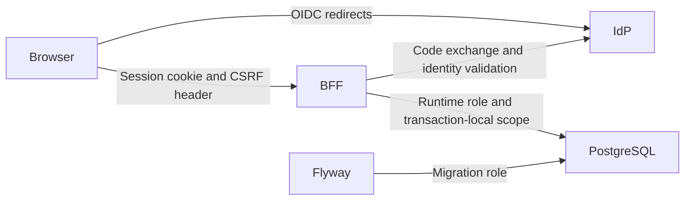

# System architecture

The workspace began with the master specification only. Use a monorepo with a same-origin React application and Spring Boot modular monolith. Use Keycloak locally and PostgreSQL as the authoritative membership store. Production identity provider, shared revocable session storage and rate-limiting topology require review. AWS London is the preferred future deployment region.

| Module | Owned responsibilities |
|---|---|
| Identity and access | OIDC session and authentication |
| Organisations | Tenants, memberships and tenant policy |
| Agency and branch | Branches and staff assignments |
| Property portfolio, landlord, tenancy | Each owns its records and associations |
| Regulatory intelligence, licensing intelligence | Rule versions and scheme coverage respectively |
| Compliance obligations | Assessments, deadlines and workflow |
| Documents, certificates, evidence | Files and versions, certificate metadata and evidence review respectively |
| Compliance Passport, proof-of-service, PRS readiness | Passport projections and grants, communications, readiness respectively |
| Tasks, notifications, reporting | Assignment workflows, delivery, exports respectively |
| Billing, integrations, platform administration | Entitlements, provider connections, privileged workflows respectively |
| Audit and security | Audit contracts, integrity checks and monitoring |

Modules call public services or handle explicit events. Repositories are internal. Use synchronous calls for immediate consistency and an outbox with idempotent consumers when asynchronous workflows arrive. PostgreSQL persistence is shared physically, with module ownership and tenant-aware constraints. Use JDBC for transaction-local scope and the initial security queries so their execution shares the same database connection.

The staging package uses an HTTPS gateway to serve the compiled React bundle and proxy selected paths to a private API. The operator supplies an isolated PostgreSQL database, OIDC issuer and secrets. Migration credentials stay outside the API container. Staging uses one API instance while browser sessions are process-local. See the [staging configuration](../../infrastructure/environments/staging/README.md).
